# Farmling

**Une ferme idle miniature qui vit au-dessus de ta barre des tâches.**
Une bande de 40 px, transparente et toujours au premier plan : un fermier, des robots et des animaux cultivent tout seuls pendant que tu travailles. Pas de fond, tout est vu de profil, en pixel art dessiné en code. Les clics traversent les zones vides : la ferme ne gêne jamais.

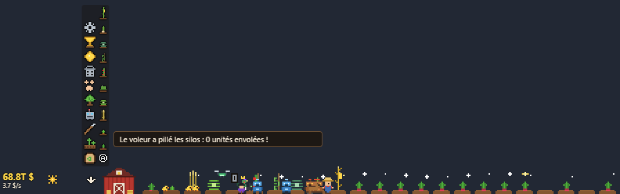

- 44 légumes répartis en 10 familles et 17 ères, 13 rangs de robots à améliorer + 8 spécialistes, 70 améliorations, 28 talents de spécialisation
- 9 compagnons (dont 4 légendaires) avec arbre de talents, évolution, 3 voies chacun et une maîtrise ; jusqu'à 5 emplacements
- Un marché vivant : silos, cours, pénuries, krachs, commandes, produits qui s'abîment
- Météo (8 temps), orages et éclairs, 13 événements aléatoires, 8 mutations, cultures denses
- Une **usine de transformation** (fin de partie) : 6 machines, 17 recettes, tapis, robots, frigos, trader et gestionnaire
- **16 gamelles** pour les compagnons et **180 effets spéciaux** (chaque compagnon, dans chaque état, en a un pour chaque gamelle)
- Ultra sobre : environ **2 % d'un cœur** et 250 Mo, rendu en 5 à 15 images/s au choix
- 32 talents de renaissance, 86 succès, une durée de vie d'environ **160 h** jusqu'à l'Arbre-monde (première renaissance vers 5 h, parties de plus en plus longues ensuite)
- Sauvegarde 100 % automatique, compatible avec un dossier synchronisé (NAS, cloud)

---

## Installer

Télécharge l'un des deux fichiers de `dist/` (ou génère-les, voir [Développement](#développement)) :

- **`Farmling-Setup-x.y.z.exe`** : installateur. Pour mettre à jour, lance simplement le nouvel installateur par-dessus l'ancien : **ta progression est conservée**.
- **`Farmling-portable-x.y.z.exe`** : version portable, sans installation (même sauvegarde que la version installée).

**Mises à jour automatiques** : la version installée vérifie les [releases GitHub](https://github.com/TisaTHor08/IdleIt/releases) au démarrage puis toutes les 4 h. Si une version plus récente existe, elle est téléchargée en arrière-plan, la partie est sauvegardée, puis la ferme s'installe et redémarre toute seule. La version portable affiche seulement une notification avec le lien de téléchargement.

La ferme apparaît en bas de l'écran, juste au-dessus de la barre des tâches.

| Commande | Effet |
|---|---|
| **Ctrl+Alt+F** | Afficher / masquer la ferme (modifiable dans les réglages) |
| Icône de la zone de notification | Afficher / masquer, réglages, quitter |
| **Clic** sur une plante | Récolter, planter, arroser, traiter ou faire pousser |
| **Clic** sur un corbeau, un sanglier, un voleur, une nuée | Le chasser (et souvent gagner une récompense) |
| **Clic** sur un compagnon | Le caresser (+XP) |
| **Clic** sur le silo | Tout vendre au marché |
| **Clic** sur la grange / l'usine | Passer du champ à l'usine, et revenir (après 13 renaissances) |
| **Clic** sur un frigo de l'usine | Tout vendre au cours (avec le trader de produits) |
| **Clic droit** ou **Échap** | Lâcher le pinceau / fermer le panneau |

---

## Comment jouer

### Les bases

Le **fermier** plante, arrose et récolte tout seul. Il dort la nuit (sauf avec la lampe frontale). Toi, tu aides en cliquant sur les plantes, et surtout tu **investis** : la flèche à gauche du HUD déplie le menu (boutique, champ, robots…) et le **pinceau** de graines.

Le pinceau sert à choisir quoi planter : sélectionne une graine puis clique sur des parcelles. Le pinceau **Auto** plante toujours la meilleure graine.

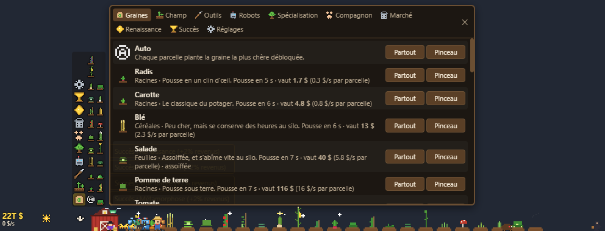

### Légumes, familles et ères

Chaque légume rapporte plus que le précédent, mais pousse plus lentement et coûte bien plus cher à débloquer. Les légumes sont classés en **familles** (racines, céréales, feuilles, fruits, légumineuses, baies, fleurs, champignons, exotiques, mythiques). Chaque famille a ses outils (grelinette, fléau, serpette, cueilleur…), ses améliorations de culture (buttes, sillons, voiles, tuteurs…) et sa durée de conservation au silo.

Les légumes de haut niveau prennent leur temps : en plus d'une pousse bien plus longue, ils ont une **durée incompressible** de pousse et de récolte, qui grandit avec leur rang. Les bonus de croissance et de vitesse raccourcissent le reste, mais jamais en dessous de ce plancher : même avec tout au maximum et les meilleurs compagnons, l'Arbre-monde met 2 min à pousser et 20 s à se récolter.

Au départ, seuls 7 légumes du potager (radis → haricot vert) existent. Chaque **renaissance** ouvre une nouvelle ère avec 1 à 3 légumes : chou, oignon et maïs, aubergine, citrouille et fraise, brocoli, champignons… jusqu'aux légumes mythiques (chou cosmique, haricot magique, fruit astral) et, tout au bout, l'**Arbre-monde** (20 renaissances).

### Champ, outils et robots

- **Champ** : achète des parcelles, l'irrigation, des paratonnerres, et fusionne tes parcelles en **cultures denses** (serrée ×3 plants, intensive ×9, quantique ×27). Une culture dense rapporte plus sur une seule place, mais planter, récolter et arroser y prennent d'autant plus de temps, et les légumes dorés y sont plus rares.
- **Outils** : vitesse du fermier, valeur des récoltes par famille, croissance, chance de légume doré…
- **Robots** : on n'achète que des **robots rouillés**, puis on les **améliore un par un** (chaque transformation se paie) : chromé, laser, drone, tracteur, androïde quantique, golem, nano-essaim… jusqu'à l'esprit de l'Arbre-monde, 13 rangs au total, dont les derniers se débloquent au fil des renaissances (jusqu'à la 20e). Ils partagent un plafond de 80 robots (+8 par niveau du talent Usine). À côté, 8 **spécialistes** s'achètent à part : arroseur, semeur, moissonneuse, soigneur, paratonnerre, épouvantail, abeille mécanique, intelligence centrale. Les robots vont plus vite que le fermier mais ont une **batterie** et retournent se recharger à la grange (bornes, panneaux solaires, charge rapide…) ; à partir du golem, plus besoin de recharger. Une fois assez nombreux, un modèle peut être **miniaturisé** (plus discret).

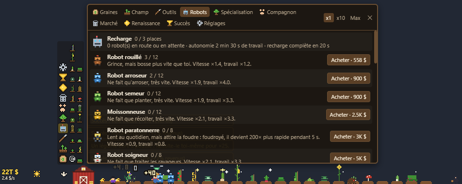

### Spécialisation

Trois branches (Mécanique, Botanique, Paysannerie) et deux doctrines exclusives, **Bio** ou **Science**. Chaque niveau acheté dans une branche rend les autres plus chères : il faut choisir un style de ferme. La Science active les **OGM** et les **mutations** tirées à la plantation : géante (plus grosse, vaut beaucoup plus, plus longue à récolter), infinie (grandit tant que tu ne la cueilles pas ; les ouvriers la récoltent à partir de ×300), carnivore, stérile, fébrile, lente, solide, moisie.

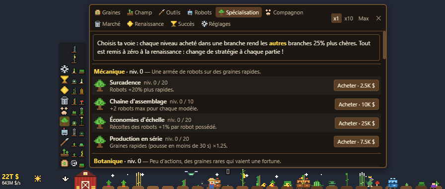

### Compagnons

Adopte un animal : chacun a un bonus, un malus et un **arbre de talents**. Il gagne de l'XP quand la ferme récolte et quand tu le caresses. Une fois évolué (poussin → coq, chien → chien de berger…) et au niveau 20, il choisit l'une de ses **3 voies** (Basilic, Phénix ou Rapace pour le coq, par exemple), puis continue de progresser en **maîtrise** (force, sagesse, éclat, rayonnement).

À chaque renaissance, tes compagnons reviennent au niveau 0. De nouveaux **emplacements** arrivent à des renaissances de plus en plus espacées : 2e emplacement à la 1re renaissance, puis aux 4e, 10e et 20e (5 au total). Tu peux y mettre le même animal en double, ou un autre. Les **compagnons légendaires** ne s'adoptent qu'après plusieurs renaissances, et sont bien plus puissants :

| Compagnon | Après | Points forts | Voies |
|---|---|---|---|
| Renard | 2 renaissances | Chasse tout, doubles récoltes, dorés | Kitsune, Fennec, Renard roux |
| Hibou | 5 renaissances | Nuits courtes et sans malus | Chouette effraie, Harfang des neiges, Chouette savante |
| Licorne | 9 renaissances | Aura magique : +60 % de croissance, +20 % de valeur | Licorne irisée, sylvestre, étoilée |
| Dragonnet | 14 renaissances | +40 % sur tous les légumes, ouvriers +20 % | Dragon d'or, Dragon de l'orage, Wyverne |

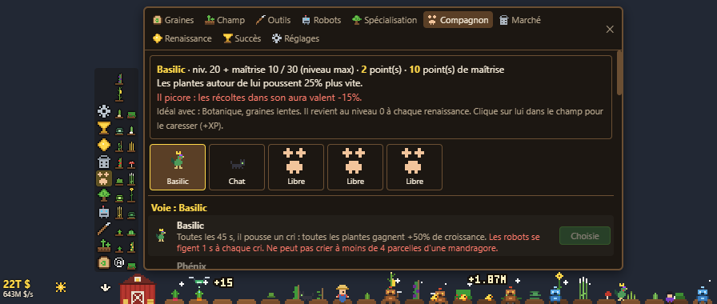
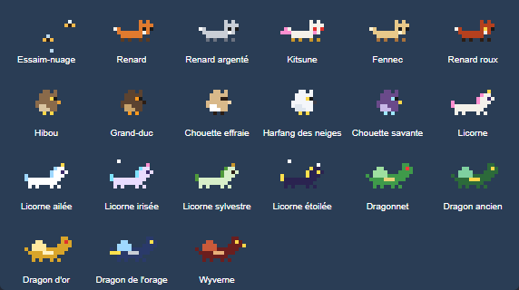

### Marché

Dès 10 M$ gagnés dans une partie, le marché ouvre. Les récoltes partent dans tes **silos**, et tu les vends quand le cours est bon (ou tu confies ça à un trader, puis à un gestionnaire).

- Les **cours** bougent sans cesse, plus fort sur les légumes bon marché. Des **pénuries** (cours ×6 à ×25) et des **krachs** frappent au hasard.
- Les **commandes** (bio, sans OGM, résistant au froid…) paient à parité avec ton meilleur légume : de quoi rendre le blé ou les carottes rentables en fin de partie. Le prix reste plafonné à 3× la rentabilité de ton meilleur légume.
- Les légumes **géants** et **infinis** remplissent plus les silos : une géante donne 8 unités, une infinie autant d'unités que son multiplicateur.
- Le trader peut apprendre la **vision du stock** : plus les silos se remplissent, moins il est exigeant sur le prix, et il vend à l'avance pour garder la place des récoltes qui arrivent.
- Les **légumes dorés** sont un produit à part, avec leur propre cours (plus nerveux), et certaines recettes de l'usine en demandent.
- Les produits **s'abîment** : la salade et les champignons pourrissent vite, le blé et les pommes de terre se gardent des heures. Chambre froide et conserverie ralentissent l'usure, et un voleur peut s'en prendre à tes silos.

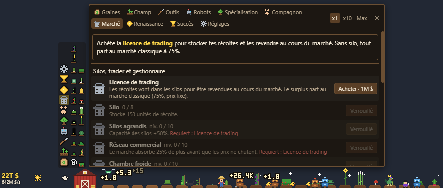

### Météo et événements

Soleil, nuages, pluie, canicule, gel (abîme les plantes, sauf sous serre), brouillard (ralentit les ouvriers, attire les corbeaux), vent (sème tout seul les parcelles vides)… et des **orages** : la foudre peut détruire une plante, geler un robot ou **énergiser** une récolte (×100). Les paratonnerres et le robot paratonnerre en profitent.

Et de temps en temps, un événement aléatoire :

| Événement | Ce qui se passe |
|---|---|
| Sanglier | Piétine les plantes : clique pour le chasser |
| Nuée de sauterelles | Dévore feuilles et fleurs : clique pour la disperser |
| Étoile filante | Une plante devient étoilée (×20 à la récolte) |
| Arc-en-ciel | Croissance ×2, dorés ×5 |
| Éclipse | La nuit en plein jour (les mandragores adorent) |
| Comète | Croissance ×2 jusqu'à l'aube |
| Foire agricole | Un juge prime ta plus belle plante mûre (×30) |
| Voleur nocturne | Vole 25 % des silos si tu ne l'attrapes pas |
| Tornade | Arrache des plantes et projette les robots |
| Panne de courant | Plus de recharge pendant 45 s |
| Oies sauvages | Les plantes survolées poussent +30 % |
| Touristes | Cueillent tes plantes mûres et les paient ×3 |
| Champignons sauvages | Poussent tout seuls après la pluie |

### Usine de transformation (après 13 renaissances)

Un pan de fin de partie, long à maximiser. Une fois l'**usine** construite (onglet Usine), un clic sur la grange fait passer la bande à l'usine ; un clic sur l'usine ramène au champ. La ferme continue de tourner pendant ce temps, et les compagnons restent toujours dans le champ.


- Les **ingrédients** viennent de tes silos. Un manutentionnaire (lent), puis des **robots porteurs**, les apportent du quai aux machines.
- **6 machines** se débloquent peu à peu (marmite, four à pain, presse, sorbetière, chocolaterie, alambic) et font **17 recettes** : compote, confiture, soupe, sirop, pain, tarte, gâteau, tarte au chou cosmique, jus, huile, glace, chocolat, parfum, élixir… dont des recettes **dorées** (confiture dorée, sorbet doré, truffes au chocolat, élixir) qui demandent des légumes dorés et valent bien plus. Chaque machine peut être réglée sur une recette, ou sur « Auto ».
- Les produits finis glissent sur le **tapis roulant** jusqu'aux **frigos**. Quand ils sont pleins, le grossiste rachète le surplus à prix fixe. Les produits s'abîment aussi, plus lentement que les légumes.
- **Robots cuistots** (machines plus rapides), **robots emballeurs** (produits plus chers), et une longue liste d'améliorations : tapis, quai, thermostats, grandes cuves (lots plus gros), recettes de grand-mère, frigos XXL, isolation.
- Le **trader de produits** donne accès au marché des produits transformés, dont les cours bougent ; sans lui, seul le grossiste achète. Le **gestionnaire d'usine** choisit la recette la plus rentable pour les machines en « Auto ». Avec la **coordination champ-usine**, il fait aussi planter par le gestionnaire de champ les ingrédients qui lui manquent.

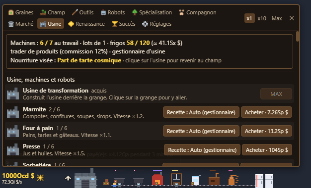

### Nourriture des compagnons

Avec la **cuisine pour animaux**, les produits du frigo deviennent des **gamelles**. Une gamelle coûte des produits et des frais. Tu la donnes au compagnon de ton choix, onglet Compagnon : elle agit **tant qu'elle est équipée**. Si tu la retires, l'effet s'arrête et la gamelle revient au placard. Les gamelles et celles qui sont équipées sont gardées à la renaissance.

Chaque gamelle donne à **chaque compagnon un effet spécial** qui lui est propre, selon son espèce ou sa voie (180 effets, 100 % des combinaisons). Chaque effet est de l'un de ces deux types :
- **Soulagement** : un effet modeste, mais la contrepartie actuelle du compagnon **disparaît**. Le chat ne perd plus de récoltes, le basilic ne fige plus les robots, le ver ne dévore plus la plante sous lui, le dragon n'attire plus les orages…
- **Marché** : un effet fort, mais une **contrepartie nouvelle** : robots ou fermier ralentis, dorés ternis, plus de corbeaux ou d'orages, nuits plus longues, terre qui sèche plus vite, marchand qui ne vient plus…

Quelques exemples :

| Gamelle | Exemples d'effets spéciaux |
|---|---|
| Coupe glacée | **Phénix givré** : son aura n'assèche plus, elle humidifie et fait pousser 60 % plus vite. **Harfang polaire** : une averse toutes les 90 s. |
| Tarte au chou cosmique | **Ver cosmique** : il traverse tout le champ, fait tout mûrir sans rien manger, et 1 plante sur 10 devient étoilée. **Basilic stellaire** : chaque cri crée une étoile. |
| Huile | **Phénix à l'huile** : aura en feu, croissance ×2 mais la terre sèche 10× plus vite. **Dragon-dynamo** : il énergise des plantes (×100). |
| Confiture | **Frelons collants** : les corbeaux englués se changent en légumes dorés. |
| Élixir | **Ver géant** : tout ce qu'il fait mûrir devient géant. **Wyverne enragée** : un rugissement toutes les 10 s. |
| Parfum | **Renard musqué** : les sangliers le suivent et labourent : toutes les parcelles vides se plantent. |
| Gâteau, soupe, chocolat… | Foires agricoles, touristes, comètes, éclipses ou arcs-en-ciel à la demande, meutes plus grandes, chat noir porte-bonheur… |

Avec le gestionnaire d'usine, tu peux **viser** une gamelle : il fait pousser les ingrédients, fabrique le produit puis cuisine la gamelle tout seul.

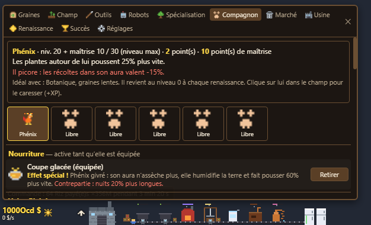

### Saisons et fêtes

Sept fêtes changent la ferme pendant 3 semaines (10 jours avant et après la date, selon l'horloge de l'ordinateur) : **nouvel an**, **nouvel an chinois**, **Saint-Valentin**, **Pâques**, **fête de la musique**, **Halloween** et **Noël**. Quand deux fêtes se chevauchent, la plus proche l'emporte.

- **2 plantes de saison** à acheter à chaque nouvelle saison (potiron hanté, sapin de Noël, pivoine impériale, rose de Saint-Valentin…). Leur prix est fixé au début de la fête d'après ta progression (la valeur de ta meilleure graine), et elles restent débloquées jusqu'à la fin de la saison, même après une renaissance. Leur valeur suit ta meilleure graine.
- **Un événement** : nuit des sorcières, traîneau du Père Noël, feu d'artifice, danse du dragon, Cupidon, chasse aux œufs, concert au champ.
- **Des bonus qui changent la meilleure stratégie** : nuits plus longues mais plus fertiles, une famille de légumes qui vaut 2× plus, une récolte sur 8 ×8, gel 4× plus fréquent, soldes de janvier…
- **Une gamelle de saison**, cuisinée avec les deux légumes exclusifs (panier de saison). Elle se garde ensuite pour toujours, avec un effet très précis utile toute l'année et une contrepartie précise. La retirer la détruit.
- **Un habillage** : décor de la ferme, tenue du fermier, couleurs de certains compagnons. Le site web change lui aussi de couleurs et de scène pendant les fêtes.

| Fête | Plantes | Gamelle de saison |
|---|---|---|
| Nouvel an (1er janvier) | Raisin de champagne, gui | Gâteau des rois : marché en folie 2,5× plus fréquent, mais fermier -20 % |
| Nouvel an chinois | Bambou, pivoine impériale | Raviolis porte-bonheur : +3 % de dorés, mais légumes -5 % |
| Saint-Valentin (14 février) | Rose, fraise en cœur | Chocolat en cœur : +12 % de doubles récoltes, mais il ne chasse plus |
| Pâques | Tulipe, carotte du lapin | Œuf en chocolat : 3 plantes dorées toutes les 3 min, mais 3 % de récoltes perdues |
| Fête de la musique (21 juin) | Calebasse, lavande | Smoothie de festival : plantes +15 %, mais +50 % de corbeaux |
| Halloween (31 octobre) | Potiron hanté, herbe de sorcière | Bonbon au potiron : chasse chaque corbeau (×3), mais nuits plus longues |
| Noël (25 décembre) | Sapin, houx | Pain d'épices : marchand ×4 toutes les 4 min, mais plantes -10 % |

Chaque gamelle de saison a aussi des **effets spéciaux** propres à 3 ou 4 compagnons (chat de sorcière, renne du Père Noël, coq du zodiaque, hibou DJ…), chacun avec sa contrepartie. Ces compagnons portent alors le **costume de la fête** toute l'année tant qu'ils gardent la gamelle : couleurs, accessoire, particules (feux follets, flocons, cœurs, notes…) et façon de bouger (le lapin sautille, le fantôme flotte, le danseur danse, le traîneau file).

### Renaissance

Une fois le **seuil** atteint (300 M$ gagnés dans la partie la première fois, environ ×10 à chaque renaissance), tu peux renaître : la ferme repart de zéro contre des **graines d'or**. Elles donnent +1 % de revenus chacune et s'échangent contre des **talents de renaissance** ciblés : argent et parcelles de départ, graine débloquée d'avance, robots d'une génération, une famille de légumes, la pluie, les événements heureux, les compagnons, le commerce…

Les graines d'or sont rares : aller bien au-delà du seuil en rapporte un peu plus, mais pas beaucoup. Chaque renaissance débloque surtout de **nouveaux légumes, robots, améliorations et compagnons**.

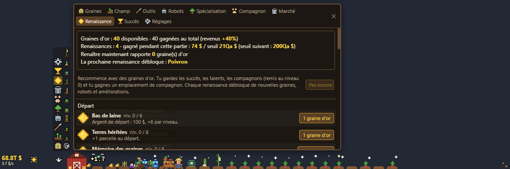

### Succès et réglages

86 succès, chacun +2 % de revenus. Dans les **réglages** : écran, taille, opacité, **animation** (60, 30, 15, 10 ou 5 images/s : moins d'images = moins de processeur, le jeu avance pareil), lancement au démarrage de Windows, raccourci clavier, dossier de sauvegarde.

Le jeu est conçu pour tourner toute la journée : simulation à 5 Hz, décor redessiné 4 fois par seconde, sprites mis en cache, canvas limité à la partie dessinée, rendu en pause quand la ferme est masquée, pas d'accélération GPU. Mesuré : environ 2 % d'un cœur et 250 Mo.

---

## Sauvegarde

Automatique, toutes les 5 s et à la fermeture, dans `%APPDATA%\IdleIt Ferme\save.json` (avec une copie `save.json.bak`). `npm start`, le portable et la version installée utilisent le même fichier.

**Dossier de sauvegarde** (Réglages) : toute la partie tient dans un dossier (`save.json` + `save.json.bak`). « Choisir… » un dossier vide y copie la partie en cours ; choisir un dossier qui contient déjà une partie la charge. Pour jouer sur plusieurs PC, choisis un dossier synchronisé (NAS, cloud…) et ne lance le jeu que sur un PC à la fois. Si la sauvegarde est modifiée ailleurs pendant que le jeu tourne, il ne l'écrase pas : la partie en cours est mise de côté dans `save-conflit-AAAAMMJJ-HHMMSS.json` et le jeu te demande laquelle garder. Les réglages (écran, taille, opacité…) restent propres à chaque PC, dans `%APPDATA%\IdleIt Ferme\settings.json`.

**Mises à jour** : la sauvegarde est hors du dossier d'installation et n'est jamais supprimée, même à la désinstallation. Au chargement, les champs manquants sont complétés et le contenu supprimé est nettoyé. Une partie d'une version antérieure à la 0.11 est convertie : ses renaissances deviennent des graines d'or (12 par renaissance) et ses talents de renaissance sont remboursés.

---

## Éditeur de sauvegarde

[`editeur-de-save.html`](editeur-de-save.html) : un seul fichier, à ouvrir dans un navigateur (double-clic). Glisse ton `save.json` dessus et modifie ta partie **sans les limites du jeu** :
- argent, renaissances, graines d'or ;
- légumes de n'importe quelle ère, améliorations, robots, talents et talents de renaissance, succès ;
- compagnons : n'importe lequel, légendaires compris, sans renaissance, avec le niveau (maîtrise comprise), la voie, l'arbre, la maîtrise et la gamelle ;
- l'usine complète, les frigos, les gamelles du placard ;
- le champ : parcelles, cultures denses, et tout faire mûrir, dorer, étoiler ou passer en géant ;
- un onglet JSON brut pour tout le reste.

« Tout débloquer » fait tout ça d'un coup. Puis « Télécharger save.json » : **ferme le jeu** et remplace l'ancien fichier (dans `%APPDATA%\IdleIt Ferme\`, ou dans le dossier choisi dans les Réglages). Rien n'est envoyé nulle part, tout se passe dans la page. Le jeu garde seulement les maximums de niveau (améliorations, talents, nœuds des compagnons).

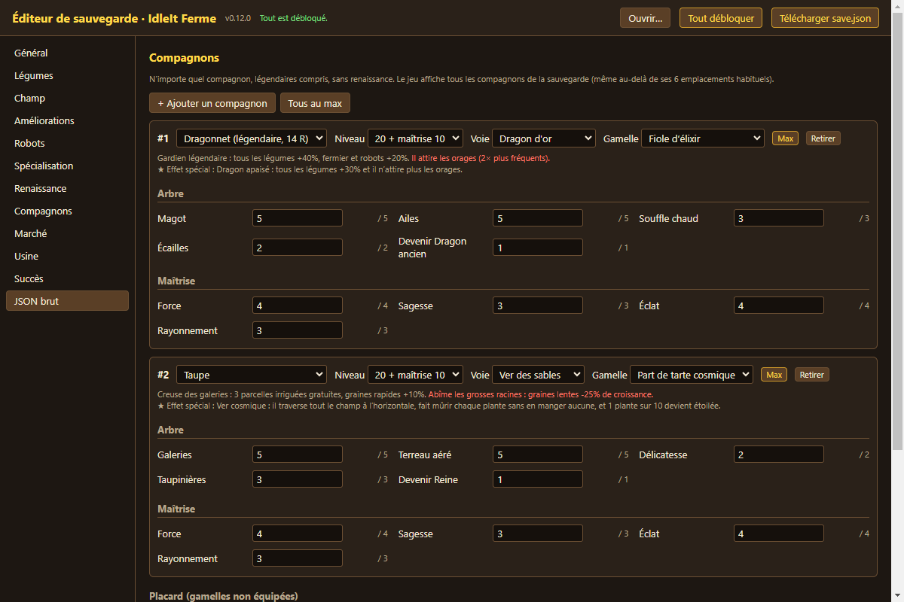

---

## Site web et wiki

Le dossier [`wiki/`](wiki/) contient un site complet, généré à partir des données du jeu : une page d'accueil de présentation, un wiki (chaque légume, chaque compagnon et ses voies, chaque gamelle et ses 36 effets, toutes les combinaisons, robots, améliorations, usine, marché, événements, renaissance, succès), une recherche, l'éditeur de sauvegarde et une page 404 aux couleurs du jeu.

```
npm run wiki            # génère wiki/dist (HTML statique)
npm run wiki:serve      # aperçu sur http://localhost:8080
npm run wiki:sprites    # réexporte les sprites du jeu en PNG (wiki/assets/img), après un changement de dessin
```

**Héberger avec Docker, mise à jour automatique** (par exemple sur un NAS) :

```
git clone https://github.com/TisaTHor08/IdleIt.git && cd IdleIt
docker compose -f wiki/docker-compose.yml up -d --build
```

Le site est servi sur le port **47320** (`http://<nas>:47320`). Deux conteneurs : `site` (nginx) et `updater`, qui vérifie le dépôt GitHub toutes les 2 minutes. Dès que le dossier `wiki/` change (ou les données du jeu, le générateur, l'éditeur de sauvegarde, la version), il régénère le site et le met en ligne d'un coup : nginx ne sert jamais un site à moitié construit, et si une construction échoue, la version en ligne reste en place. Il suffit donc de pousser sur `main` : le NAS suit tout seul, sans ouvrir de port ni configurer de clé.

Réglages (fichier `.env` à côté du compose, ou variables d'environnement) :
- `WIKI_PORT` (47320 par défaut) ;
- `SITE_URL` : liens canoniques et `sitemap.xml` ;
- `BRANCH` (`main`) ;
- `INTERVAL` (120 s) ;
- `REPO_URL`, pour suivre un fork.

Pour voir ce que fait l'updater : `docker logs -f farmling-site-updater`.

**Image figée** (sans mise à jour) : `docker build -f wiki/Dockerfile -t farmling-wiki .` puis `docker run -d -p 47320:80 farmling-wiki`. L'image construit le site avec Node, puis le sert avec nginx. Les deux modes ont gzip, le cache, les en-têtes de sécurité et un conteneur nginx en lecture seule.

Le site vise 100 partout sur PageSpeed : HTML statique avec le CSS en ligne, JavaScript seulement pour la recherche et l'éditeur (différé), images dimensionnées et chargées à la demande, sprites nets à la bonne résolution.

---

## Développement

Electron + JavaScript, sans framework ni dépendance d'exécution. Node.js 20 ou plus.

```
npm install
npm start                 # jouer
npm run debug             # jouer en affichant les erreurs du jeu dans le terminal
npm run build             # dist/Farmling-portable-x.y.z.exe et l'installateur
```

### Tests et équilibrage

```
node tools/test-v4.js       # renaissances, ères, compagnons multiples, maîtrise, périssabilité, 13 événements
node tools/test-paths.js    # les 27 voies de compagnons (et le verrouillage des légendaires)
node tools/test-market.js   # marché
node tools/test-storm.js    # orages
node tools/test-dense.js    # cultures denses et miniaturisation
node tools/test-giant.js    # les 8 mutations
node tools/test-seasons.js  # saisons : dates (Pâques, nouvel an chinois, chevauchements), plantes, événements, gamelles de saison
node tools/test-factory.js  # usine, légumes dorés à part, gamelles (576 combinaisons compagnon × voie × gamelle), pouvoirs
node tools/sim-life.js 200 20       # partie complète simulée : 20 renaissances, au plus 200 h
npm run sim -- 6 50 bota+bio+trade  # une seule partie (branches, +trade = marché)
npm start -- --farm-savetest        # dossier de sauvegarde et conflits (dossier temporaire)
npm run save-editor                 # régénère editeur-de-save.html (à relancer quand le contenu du jeu change)
npx electron tools/test-save-editor.js   # test de l'éditeur (rendu hors écran) : la partie éditée se charge dans le jeu
npm start -- --farm-perf --farm-demo=tools/demo-factory.js   # CPU et mémoire sur 30 s, temps de rendu / simulation
npm start -- --farm-shots --farm-demo=tools/demo-v4.js   # captures de chaque onglet dans tools/shots
python tools/readme-shots.py        # recadre tools/shots pour docs/img
```

Les captures s'exécutent dans une fenêtre à 1 % d'opacité (invisible à l'écran) qui se ferme toute seule.

`sim-life.js` joue avec un acheteur glouton (`PNOW=1` : renaît dès le seuil) et accepte des réglages d'essai par variables d'environnement (`UNLR`, `VALR`, `GPOW`/`GALL`, `TPOW`, `RPOW`, `DT`, `TRACE=secondes`). `CALIB=1` recalibre les seuils : chaque partie dure `CALIB_A + CALIB_B × renaissances` heures et son seuil devient ce que le bot a gagné ; on lisse ensuite la courbe avant de la reporter dans `PRESTIGE.thresholds`. Vérification actuelle : 155 à 160 h pour 20 renaissances. Repère clé : la somme des « rendements » de tout ce qui s'achète (effet par niveau / hausse de prix par niveau) doit rester inférieure à 1, sinon chaque partie finit en explosion de quelques minutes. C'est le rôle de `COST_CURVE` dans data.js.

### Ajouter du contenu

Presque tout se trouve dans [src/renderer/js/data.js](src/renderer/js/data.js) : ajoute une entrée dans un tableau et l'interface suit. Le champ `pr` (nombre de renaissances requises) existe sur les graines, les robots, les améliorations et les compagnons.

| Quoi | Tableau | Notes |
|---|---|---|
| Légume | `SEED_LIST` | `[id, nom, famille, forme, feuillage, fruit, pr, options]`. Valeur, temps de pousse, prix et conservation sont calculés (`ECO`, `FAMILIES`) ; les améliorations d'une famille apparaissent avec son premier légume. Formes dans `drawPlant` de [sprites.js](src/renderer/js/sprites.js) : `root`, `leafy`, `vine`, `stalk`, `spear`, `ground`, `mandrake`, `cosmic`, `grain`, `tuber`, `pod`, `bulb`, `bush`, `flower`, `mushroom`, `tree`, `cactus`. |
| Famille | `FAMILIES` | Nom et durée de conservation au silo (s). |
| Robot | `ROBOTS` | `walk`, `act`, `fly`, `only` (robot spécialisé), `tag` (ancien, moderne, volant, futur), `hub`, `scare`, `noBattery`, `drain`. Couleurs dans `ROBOT_PAL` de sprites.js. |
| Amélioration | `UPGRADES` | `tab` : `outils`, `champ`, `robots`, `marche`. Effet générique avec `fx: [{ k, mult \| add, fam, seed, robot, tag, ev }]` (lu par `fxMul`/`fxAdd` de core.js), ou codé avec `this.lvl('id')`. `g` est élevé à `COST_CURVE`. |
| Talent de spécialisation | `TALENTS` | `branch`, `req`. Effet avec `this.tal('id')`. |
| Talent de renaissance | `PERKS` | `cat` (voir `PERK_CATS`), `fx` comme les améliorations, ou `this.perk('id')`. |
| Compagnon | `PETS` | `nodes` (arbre, un nœud `evo: true`), `mods(L, evo)` → modificateurs de `PET_MOD_DEFAULTS`, `pr` pour un légendaire (son prix suit le seuil de son ère). Gardez les nœuds hors évolution ≤ 15 points. Sprite : `PET_SPRITES` (`<id>`, `<id>_evo`, une entrée par voie) ; les légendaires sont dessinés par le cas générique de `drawPet`. |
| Voie | `PET_PATHS` | 3 par compagnon, `mods(L, base)` remplace des modificateurs (cri, perchoir, meute, ver, gemmes…). |
| Maîtrise | `MASTERY`, `PET_LEVEL` | Niveaux après le niveau 20, une fois la voie choisie. |
| Événement | `EVENTS`, `EVENT_FX` | Poids `w`, condition `when`, `good`. Logique dans [events.js](src/renderer/js/events.js) (`startEvent`, `update…`), sprites dans sprites.js. |
| Météo | `WEATHER` | `growth`, `evap`, `rain`, `w`, et des effets propres (`frost`, `fog`, `wind`) traités dans `updateWeatherEffects`. |
| Marché | `MARKET`, `TRAITS` | Cours, pénuries/krachs (`shortage`, `crash`), parité des commandes, plafond `parityCap`, pourriture (`rotten`). Logique dans [market.js](src/renderer/js/market.js). |
| Culture dense | `DENSE` | Plants, `costMult`, `growth`. |
| Mutation | `MUTATIONS` | `value`, `harvest`, `growth`, `fail`, `mold`, `infinite`, `catcher`, `good`. |
| Succès | `ACHIEVEMENTS` | `check: g => …` (`g.s` = état sauvegardé). |
| Usine | `FACTORY`, `MACHINES`, `RECIPES`, `FACTORY_ROBOTS`, améliorations `tab: 'usine'` | Prix en multiples de `FACTORY.base`. Recette : `inputs: [{ fam \| seed, n, gold }]`, `out`, `time`, `mult`, `shelf`. Logique dans [factory.js](src/renderer/js/factory.js), sprites `drawMachine` (un dessin par machine dans `MACHINE_DRAW`). |
| Saison | `SEASONS`, `SEASON_SEED_LIST`, `SEASON_EVENTS`, `SEASON_FOODS` | `date(y) → [mois, jour]`, `fx`, `mods`/`modsAdd`, `weather`, `discount`, `lucky8`, `crowReward`. Habillage : `FARMER_SEASON_PAL`, `PET_SEASON_PAL`, `drawSeasonDeco`, `drawSeasonFx` (sprites.js). Logique : [seasons.js](src/renderer/js/seasons.js). Dans Node (tests, simulateur), pas de saison sauf `FARM_SEASON=<id>` ou `FARM_SEASON=auto`. |
| Gamelle | `PET_FOODS` | `recipe`, `units`, effet `any` + `special: [{ pet \| path, desc, mods(pm) }]`. Les pouvoirs périodiques (`powers` : pluie, étoiles, dorés, maturation, plantation, événements…) sont exécutés par `petPower` de pets.js. |
| Renaissance | `PRESTIGE` | Seuils `thresholds` (calibrés, ×1000 par renaissance au-delà), gain `gsBase × (gagné / seuil)^gsExp`, emplacements de compagnons. Les légumes d'une ère coûtent `ECO.eraMult` × le seuil précédent. |

### Structure

```
src/main.js                 fenêtre Electron, placement, click-through, raccourci, sauvegarde fichier, captures
src/preload.js              pont sécurisé entre Electron et le jeu
src/renderer/js/data.js     tout le contenu et l'équilibrage
src/renderer/js/core.js     la logique (sans DOM, réutilisée par les tests et le simulateur)
src/renderer/js/pets.js     compagnons (emplacements, arbres, voies, maîtrise)
src/renderer/js/market.js   silos, cours, commandes, fraîcheur, trader, gestionnaire
src/renderer/js/events.js   événements aléatoires et effets de la météo
src/renderer/js/factory.js  usine : machines, porteurs, tapis, frigos, produits, gamelles
src/renderer/js/sprites.js  pixel art dessiné en code
src/renderer/js/render.js   rendu de la bande
src/renderer/js/ui.js       HUD, panneau, info-bulles, notifications
src/renderer/js/app.js      boucle, sauvegarde, souris
tools/                      tests, simulateurs, démos de capture, lanceur, icône
docs/img/                   captures du README
```
